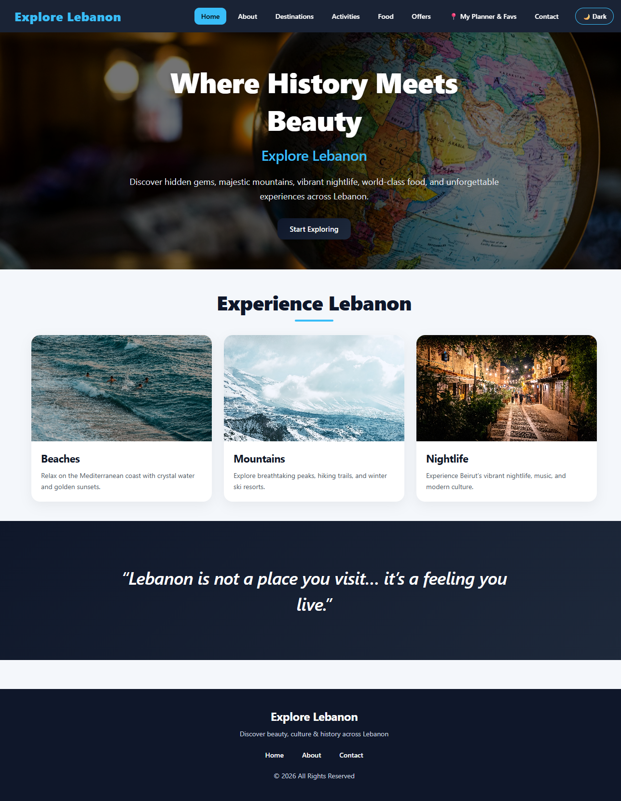
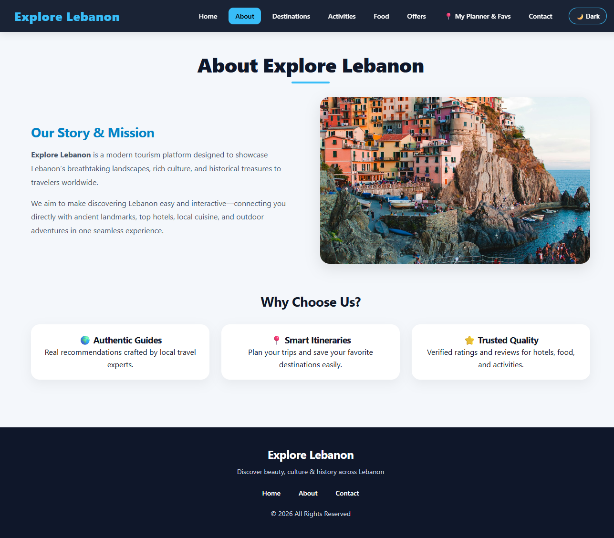
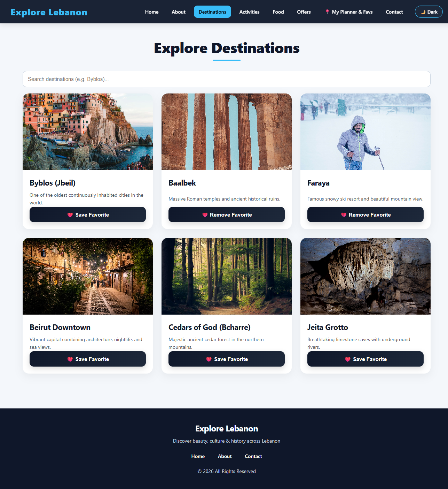
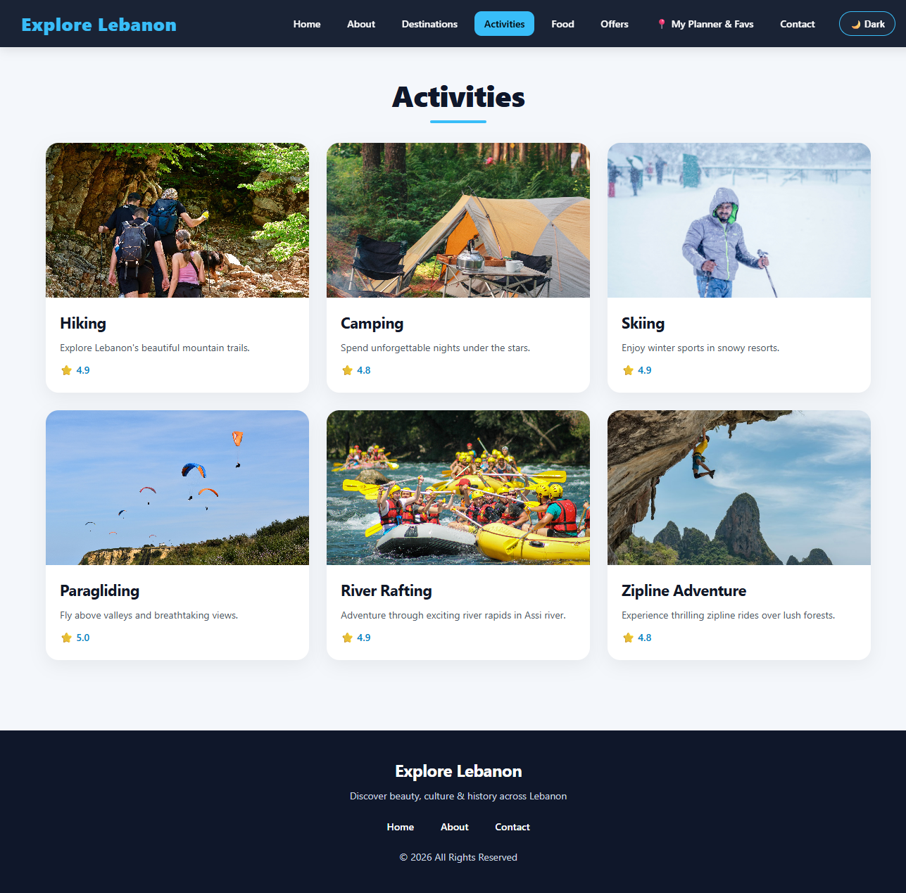
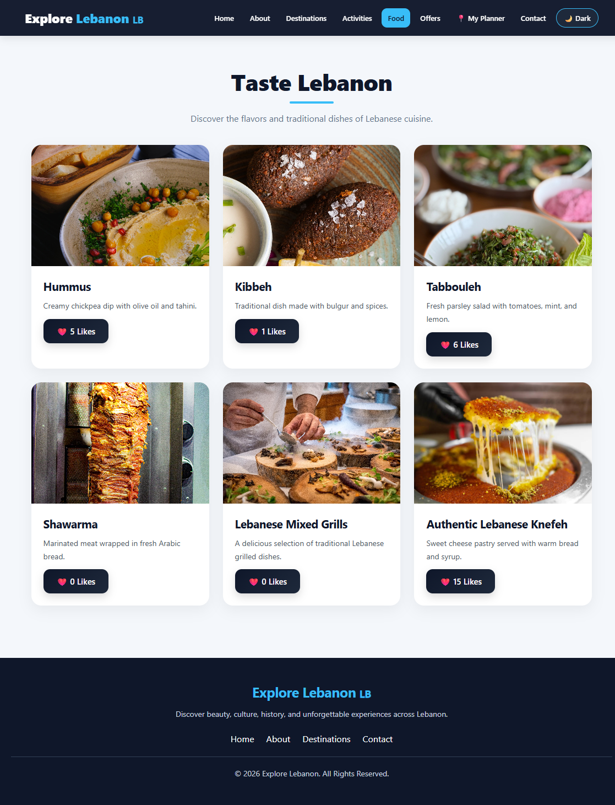
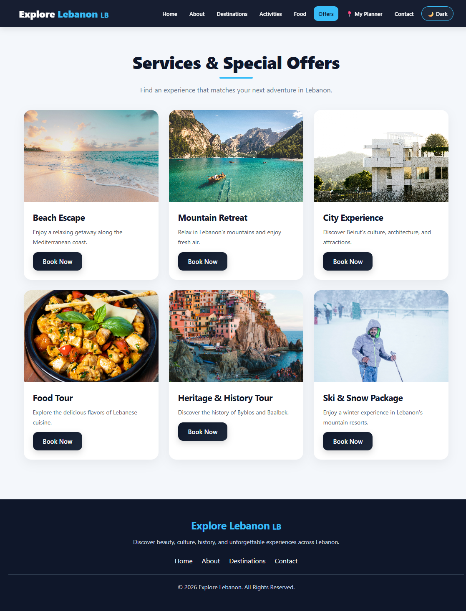
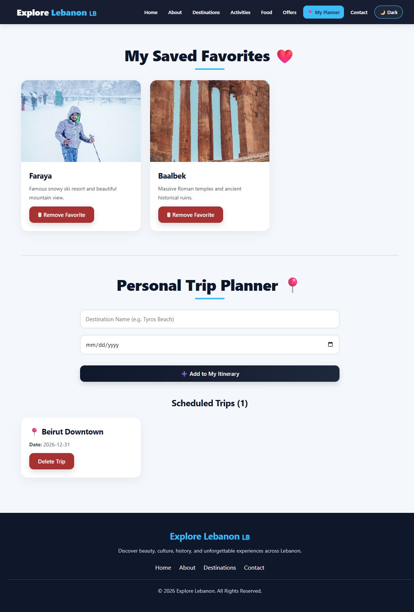
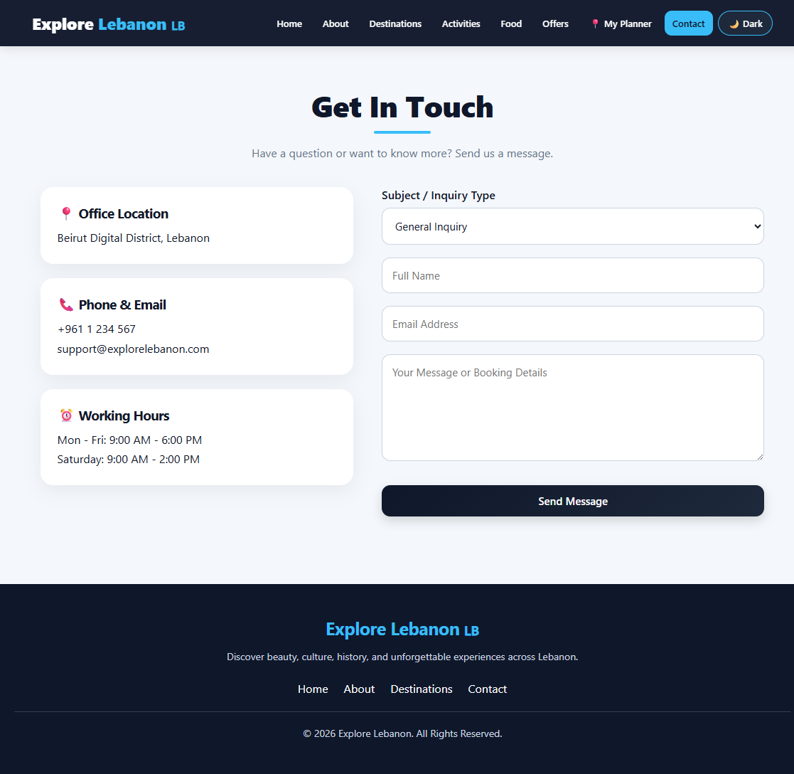
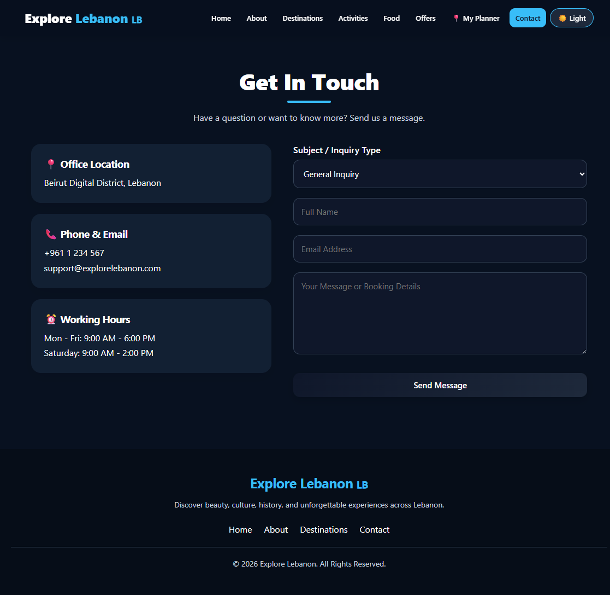

Explore Lebanon 🇱🇧

## Project Description:

Explore Lebanon is a responsive tourism web application developed using ReactJS and Vite. It aims to introduce users to Lebanon's beautiful landscapes, cultural heritage, historical landmarks, traditional food, and outdoor activities through an interactive and user-friendly interface.

The application uses React Router DOM for client-side navigation and browser Local Storage to save user preferences and data.

## Key Features & Pages:

- Home ("/"): Includes a hero banner, featured experiences such as beaches, mountains, and nightlife, and an inspiring Lebanese quote.
- About ("/about"): Introduces the project's story, mission, and main values.
- Destinations ("/destinations"): Displays tourist destinations with a search function and the ability to save favorite places.
- Activities ("/activities"): Showcases outdoor and recreational activities such as hiking, camping, skiing, paragliding, rafting, and ziplining.
- Food ("/food"): Presents traditional Lebanese dishes such as hummus, kibbeh, tabbouleh, shawarma, mixed grills, and knefeh, with an interactive Like Counter.
- Offers ("/offers"): Displays travel packages with a Book Now button that redirects users to the Contact page with the selected offer.
- My Planner ("/planner"): Allows users to manage favorite destinations and create, save, and delete personal trip plans.
- Contact ("/contact"): Provides a contact form with input validation for the name, email, and message.

## Additional Features:

- Dark Mode: Allows users to switch between light and dark themes. The selected theme is saved using Local Storage.
- Scroll To Top: Provides a floating button that allows users to smoothly return to the top of the page.
- Persistent Data: Uses Local Storage to preserve favorites, food likes, trip plans, and theme preferences.
- Responsive Design: Adapts the website layout to different screen sizes, including desktop and mobile devices.

## Technologies Used:

- ReactJS: Frontend development.
- Vite: Development server and build tool.
- JavaScript (ES6+): Application logic and interactivity.
- React Router DOM: Navigation between pages.
- HTML5: Website structure.
- CSS3: Styling and responsive layouts.
- React Hooks (`useState`, `useEffect`): State management and side effects.
- Browser Local Storage: Saving user preferences and data.
- Git & GitHub: Version control and source code management.
- Netlify: Website deployment.

## Installation and Setup:

Follow these steps to run the project locally.

1. Clone the Repository

git clone https://github.com/janaserrieh2/lebanon-explorer-phase_1.git

2. Navigate to the Project Folder

cd lebanon-explorer-phase_1

3. Install Dependencies

npm install

4. Run the Development Server

npm run dev

5. Open in Browser

Open the local URL displayed in the terminal, usually:

http://localhost:5173

## Project Links:

- Live Demo: https://lebanon-explorer-phase1.netlify.app
- GitHub Repository: https://github.com/janaserrieh2/lebanon-explorer-phase_1

## Screenshots:

The following screenshots demonstrate the website's interface and main features.

### Home Page

### About Page

### Destinations Page

### Activities Page

### Food Page

### Offers Page

### My Planner & Favorites Page

### Contact Page

### Dark Mode

## Team Members

- Jana Serrieh
- Rawan Abou Alloul
